# 软件工程 UML 图集（时序图 / 类图 / 活动图 / 组件图 / 状态图 / E-R）

本文件与《软件工程-实验3-报告内容.md》配套：图1（学生端用例图）、图2（管理员端用例图）在实验3 报告中，这里补齐其余各类图，供实验4（概要设计）、实验5（详细设计）直接取用。

| 图号 | 图类型 | 主题 | 服务的实验 |
|---|---|---|---|
| 图3 | 时序图 | 提交代码与异步判题 | 实验5 详细设计 |
| 图4 | 类图 | 领域实体与服务模块 | 实验5 详细设计 |
| 图5 | 活动图 | 判题器内部流程 | 实验5（补充） |
| 图6 | 组件图 | 系统组成与接口 | 实验4 概要设计 |
| 图7 | 状态图 | 提交记录生命周期 | 实验5（补充） |
| 图8 | 状态图 | 题目生命周期 | 实验5（补充） |
| 图9 | E-R 图 | 数据库设计 | 实验5 详细设计 |

> 所有图均以 PlantUML 源码给出，渲染方法与实验3 相同（见文末附录）。

---

## 图3 时序图：提交代码与异步判题

**用途**：展示一次提交从浏览器到判题完成的全过程，重点体现"**提交立刻返回、判题在后台异步执行**"。

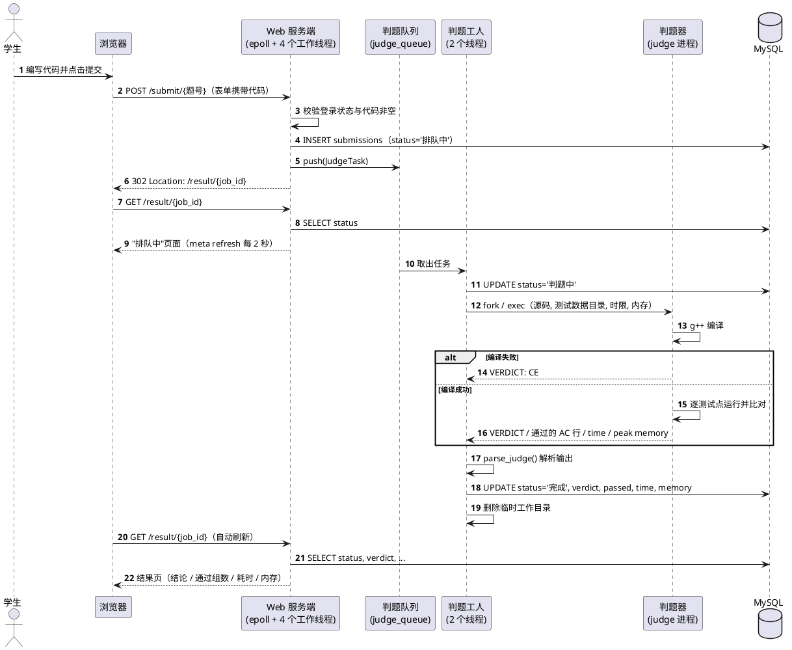

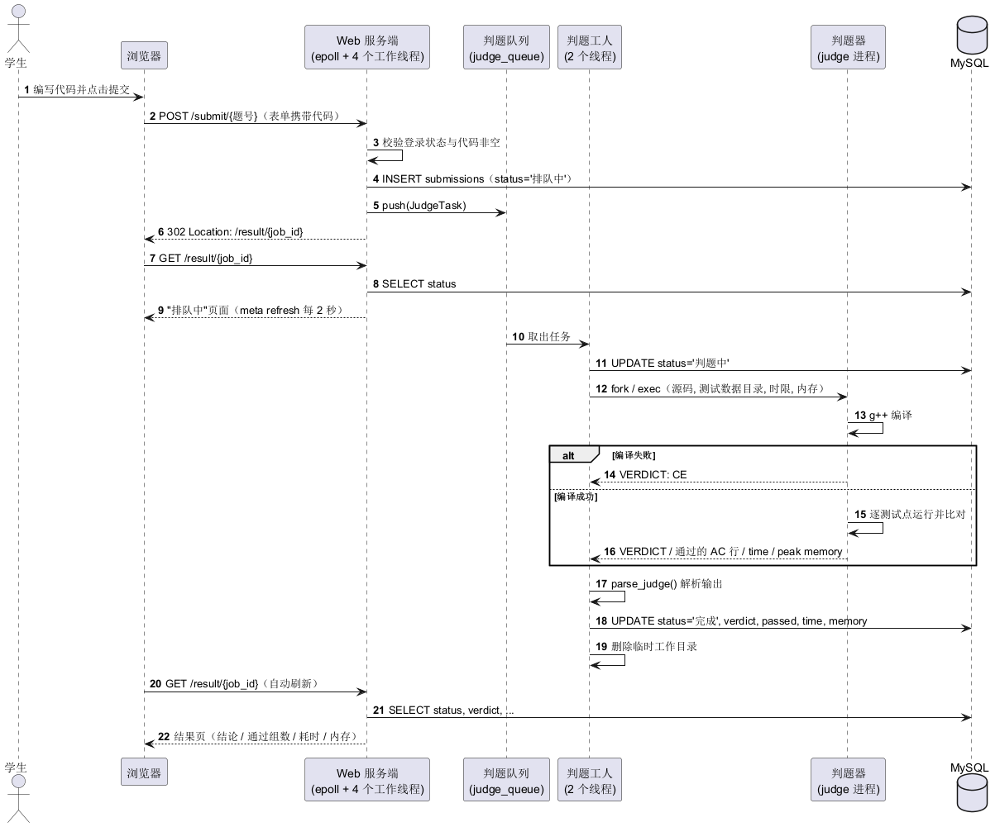

**读图要点**：
1. **两次 HTTP 请求不是一次**：提交只负责"接住并落库"，然后 302 到结果页；判题在另一个线程里进行，所以提交响应时间与判题耗时无关（实测 2.10 s → 0.0032 s）。
2. **两条队列**：`task_queue` 装的是 HTTP 连接（epoll 接收后交工作线程），`judge_queue` 装的是判题任务（提交后交判题工人），两者互不阻塞。
3. **判题器是独立进程**：Web 端通过 `fork/exec` + 管道拿它的 stdout，因此判题器崩溃不会带崩服务端。
4. **alt 分支**对应"编译失败即 CE，不进入运行阶段"。

---

## 图4 类图：领域实体与服务模块

**用途**：详细设计阶段的核心类图，展示实体属性、服务职责与关系。

> 说明：领域实体对应数据库表；`HttpServer`、`JudgeRunner` 是**模块抽象**（实际实现为自由函数 + 全局队列 + 线程池），类图用于表达职责划分，不要求与代码一一对应。

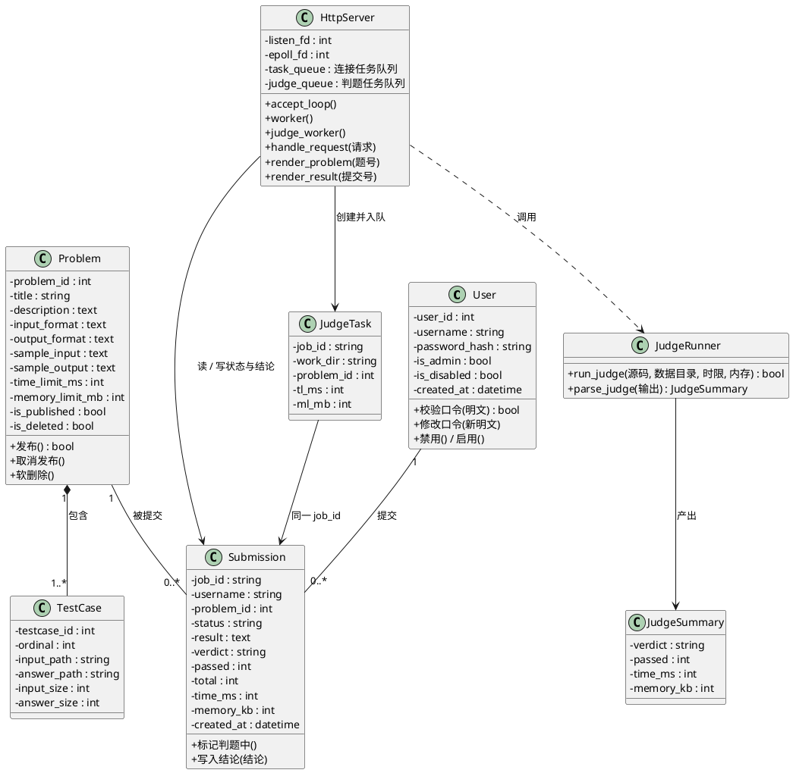

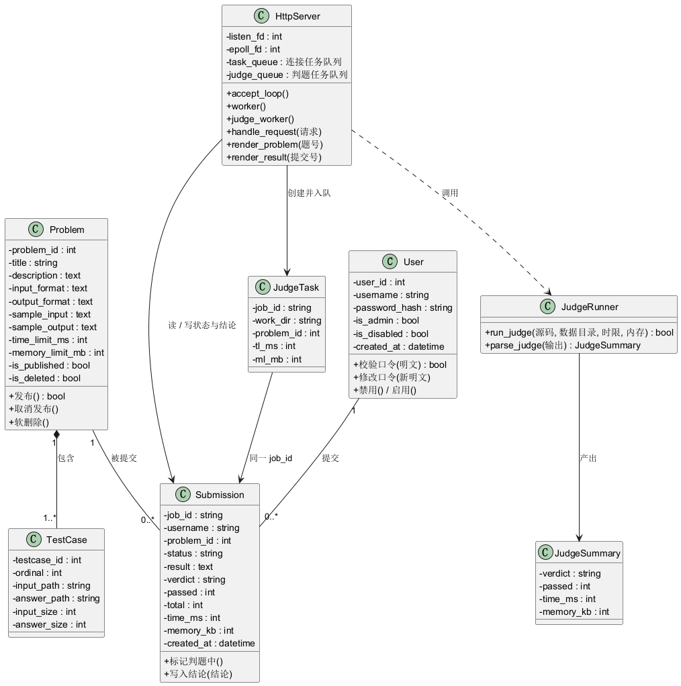

**读图要点**：
1. **组合关系** `Problem *-- TestCase`：测试点脱离题目没有意义，题目删除时一并处理（实心菱形画在题目一端）。
2. **关联** `User -- Submission`、`Problem -- Submission`：一条提交同时指向一个人和一道题；两次都是 1 对多。
3. `JudgeTask` 是队列中的消息，携带 `job_id` 与运行参数；`JudgeSummary` 是判题器输出的解析结果，二者都是传值对象。

---

## 图5 活动图：判题器内部流程

**用途**：把 `judge_demo/judge.cpp` 的控制流画清楚，是"详细设计"里最能体现判题业务的一张图。

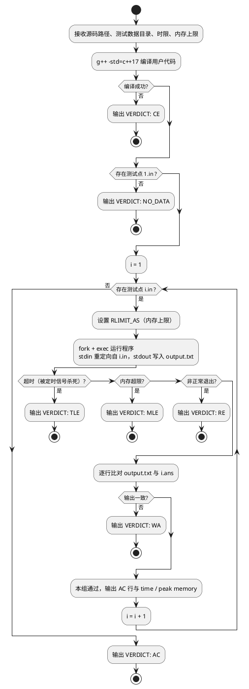

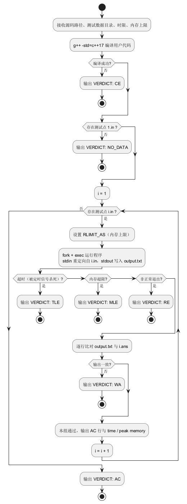

**读图要点**：
1. **遇到第一个不通过的测试点就停止**，不再跑后面的测试点（所以 `passed` 只统计已经通过的前缀组数）。
2. **判定优先级**：超时 → 内存 → 异常退出 → 输出不一致，四者是 `elseif` 关系，不会同时成立。
3. **NO_DATA 是系统侧问题**（没有测试数据），与用户代码无关，单独判定。

---

## 图6 组件图：系统组成与接口

**用途**：概要设计阶段的系统结构图 / 模块依赖图，展示组件及其提供的、需要的接口。

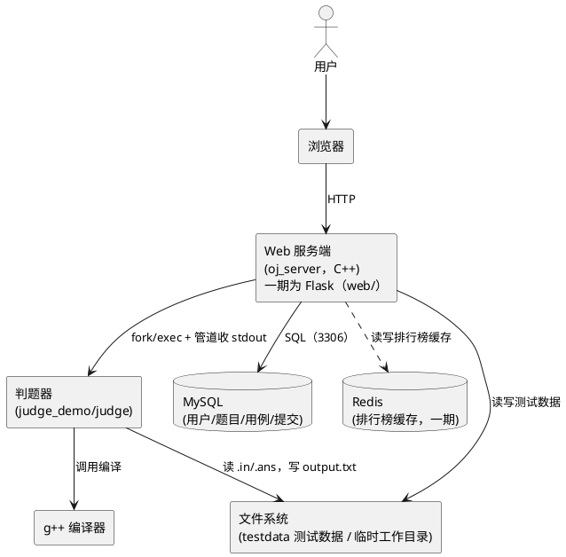

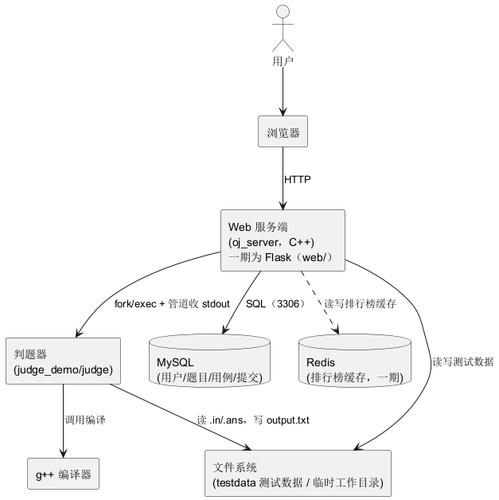

**读图要点**：
1. **Web 层与判题层解耦**：两者之间只有"命令行参数 + 管道 + 退出码"这一条接口，所以一期 Flask 换二期 C++，判题器完全不受影响——这正是分层的价值。
2. **测试数据走文件系统**，数据库只存元信息（序号、路径、大小），避免大文本进出数据库。
3. **Redis 目前只服务于排行榜缓存**（一期实现）；二期 C++ 服务端尚未接入，图中以虚线依赖表示可选。

---

## 图7 状态图：提交记录生命周期

**用途**：展示一条提交记录在数据库中的状态迁移。

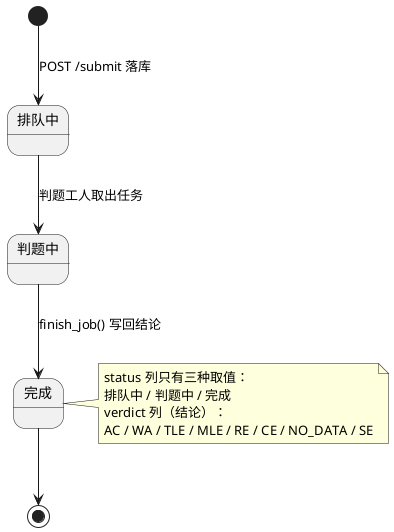

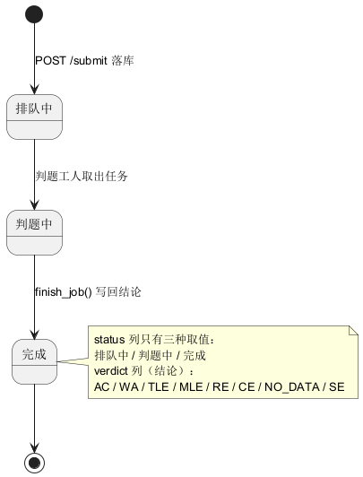

**读图要点**：
1. **状态与结论分开存**：`status` 回答"判完了没有"，`verdict` 回答"判成什么"，所以页面用 `status == 完成` 决定还要不要自动刷新。
2. **没有失败终态**：判题器没启动起来也落到"完成"，只是 `verdict = SE`，保证结果页一定能停住（否则页面会永远 2 秒刷新）。
3. 若扩展重判功能，只需从"完成"加一条回到"排队中"的转移。

---

## 图8 状态图：题目生命周期

**用途**：展示题目从草稿到发布、软删除的业务状态。

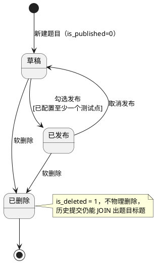

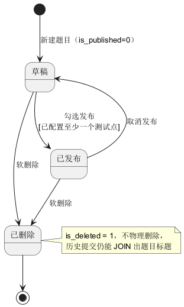

**读图要点**：
1. **守卫条件** `[已配置至少一个测试点]` 就是需求里的业务规则，对应服务端"无测试点不允许发布"的校验。
2. **软删除而非物理删除**，避免历史提交变成取不到标题的孤儿记录。

---

## 图9 E-R 图：数据库设计

**用途**：数据库概念结构设计，对应实验5 的"至少 2 张表、第三范式"要求（实际 4 张表）。

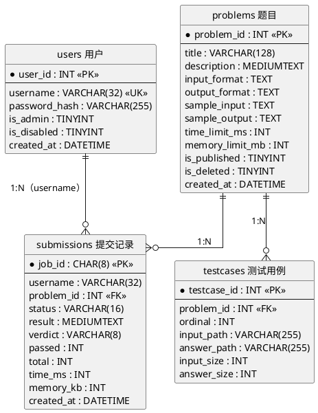

**读图要点**：
1. **主键**：users / problems / testcases 用自增整型，submissions 用 8 位十六进制 `job_id`（提交时就能生成，落库与跳转不依赖自增回填）。
2. **外键**：`testcases.problem_id`、`submissions.problem_id` 有物理外键；`submissions.username` 与用户是**逻辑关联**（用户名可空，历史数据中没有填写者），图中保留这条关系以体现业务含义。
3. **第三范式**：四个实体各自只存自身属性；测试点的输入输出正文不放进题目表（避免多值导致重复组），只存路径与大小；提交的结论字段直接依赖主键 `job_id`，不存在传递依赖。
4. **唯一约束**：`users.username` 唯一；`testcases (problem_id, ordinal)` 唯一，保证测试点序号不重复。

---

## 附：渲染与插入报告的方法

1. 打开 <https://www.plantuml.com/plantuml/uml/>（或 VS Code 的 PlantUML 插件），粘贴某一图的完整源码（`@startuml` 到 `@enduml`，不要带 Markdown 的代码围栏）；
2. 确认中文正常、关系方向正确；
3. 右键图 → **Save as PNG**（要清晰就在源码第二行加 `skinparam dpi 200`）；
4. 按图号命名为 `图3-时序图.png`、`图4-类图.png`……插入《软件工程实验报告汇总版》对应实验的报告纸；
5. 一页放不下时另起一页。
