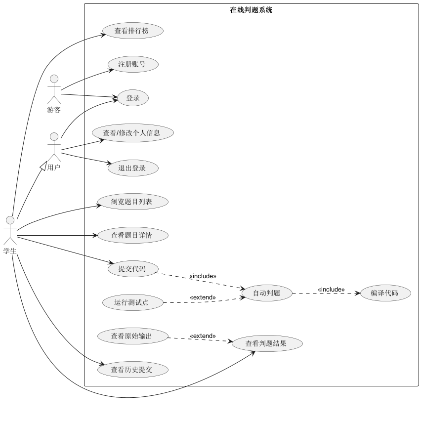
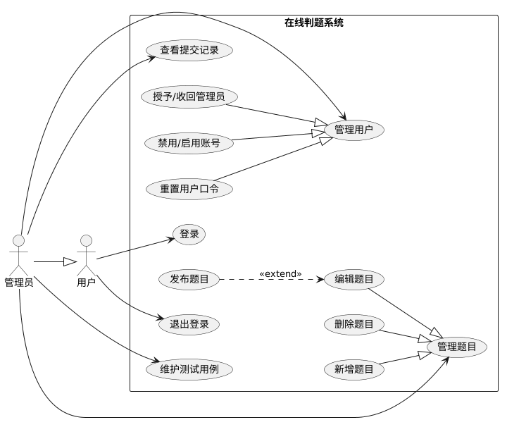
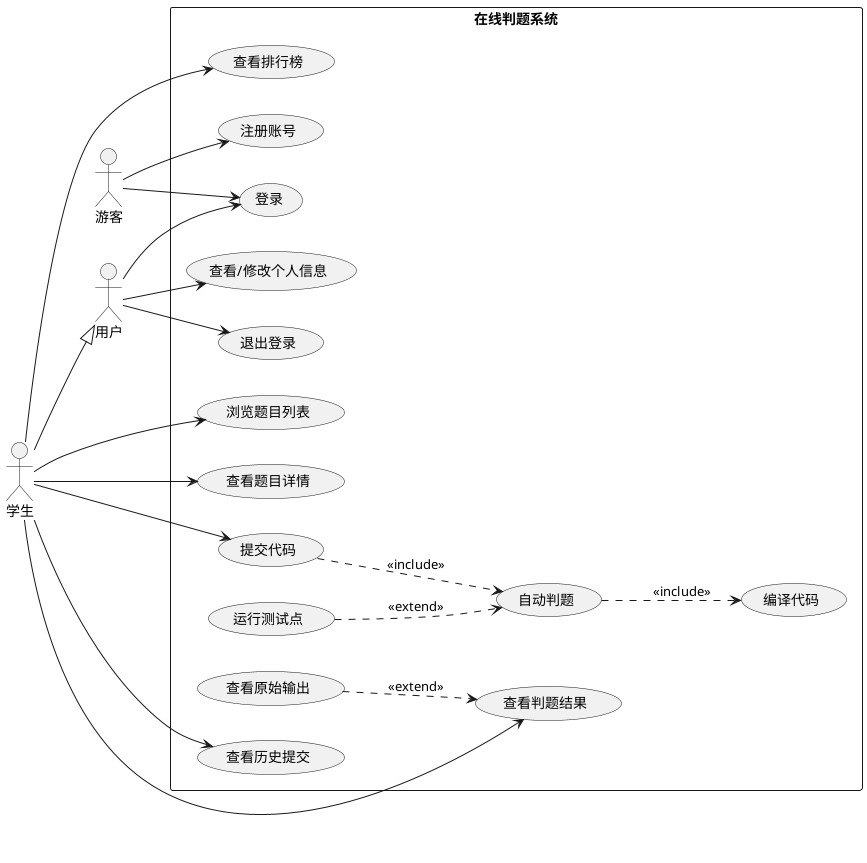
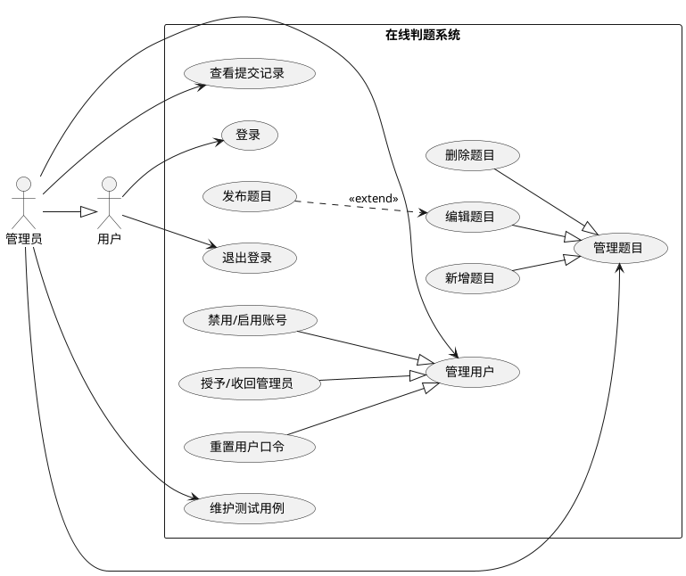

# 软件工程实验报告 —— 实验3：UML 建模

**姓名**：刘逸涵　**学号**：2024103652　**学院**：网络空间安全学院　**专业**：网络空间安全　**班级**：1 班
**课程**：《软件工程实验》　**指导教师**：甘文生　**实验时间**：2026 年 10 月 20 日

---

## 一、实验目的

1. 掌握面向对象的建模方法，理解 UML 结构图与行为图的分类；
2. 学会使用 UML 建模工具（PlantUML / draw.io）绘制用例图；
3. 基于实验2 的需求分析成果，用用例图描述系统需求，并区分参与者、用例及其关联 / 包含 / 扩展 / 泛化关系。

## 二、实验环境

| 类别 | 工具 |
|---|---|
| 建模工具 | PlantUML（源码描述 + 在线渲染）、draw.io（版面调整与导出） |
| 需求依据 | 《软件需求规格说明书（在线判题系统）》第 3 章功能需求 |
| 文档工具 | Markdown → Word（实验报告汇总版） |

## 三、实验内容与步骤

1. 阅读 UML 建模资料，区分结构图（类图、组件图）与行为图（用例图、时序图、活动图、状态图），本实验聚焦**用例图**；
2. 从需求规格说明书中提取两类参与者（游客 / 学生 / 管理员）与各功能点，整理**用例清单**；
3. 按"是否每次都发生"判定 **include**、按"条件满足才发生"判定 **extend**、按"子用例复用父用例语义"判定**泛化**，逐条写明判定依据；
4. 绘制**学生端**与**管理员端**两张用例图（参与者、用例、关系齐全，含系统边界）；
5. 选取 3 个核心用例编写用例描述，并与需求编号对应，检查需求覆盖。

---

## 四、参与者与用例清单

### 4.1 参与者

| 参与者 | 类型 | 说明 |
|---|---|---|
| 游客 | 人 | 未登录的访问者，只能注册与登录 |
| 用户 | 人（抽象） | 已登录用户的一般化角色，拥有登录、退出、个人信息等公共用例 |
| 学生 | 人 | 继承"用户"，可浏览题目、提交代码、查看结果与排行榜 |
| 管理员 | 人 | 继承"用户"，额外拥有题目、测试用例、用户的管理权限 |

### 4.2 学生端用例

| 编号 | 用例 | 参与者 | 说明 | 对应需求 |
|---|---|---|---|---|
| UC-S01 | 注册账号 | 游客 | 填写用户名与口令创建学生账号 | OJ-USR-01 |
| UC-S02 | 登录 | 用户 | 校验凭据并建立会话 | OJ-USR-02 |
| UC-S03 | 退出登录 | 用户 | 销毁会话 | OJ-USR-02 |
| UC-S04 | 查看 / 修改个人信息 | 用户 | 查看账号信息、修改口令 | OJ-USR-03 |
| UC-S05 | 浏览题目列表 | 学生 | 查看全部已发布题目 | OJ-PRB-01 |
| UC-S06 | 查看题目详情 | 学生 | 查看题面、输入输出格式、样例、时限与内存 | OJ-PRB-02 |
| UC-S07 | 提交代码 | 学生 | 粘贴 C++ 代码并提交 | OJ-SUB-01 |
| UC-S08 | 自动判题 | 系统 | 编译、运行、比对并给出结论 | OJ-JDG-01～09 |
| UC-S09 | 编译代码 | 系统 | 调用 g++ 编译，失败即 CE | OJ-JDG-01 |
| UC-S10 | 运行测试点 | 系统 | 逐个测试点运行并比对输出 | OJ-JDG-02～05 |
| UC-S11 | 查看判题结果 | 学生 | 查看结论、通过组数、耗时、内存 | OJ-REC-01 |
| UC-S12 | 查看原始输出 | 学生 | 非 AC 时查看程序原始输出，便于调试 | OJ-REC-01 |
| UC-S13 | 查看历史提交 | 学生 | 按时间倒序查看本人提交记录 | OJ-REC-02 |
| UC-S14 | 查看排行榜 | 学生 | 按通过题数排名 | OJ-RNK-01 |

### 4.3 管理员端用例

| 编号 | 用例 | 参与者 | 说明 | 对应需求 |
|---|---|---|---|---|
| UC-A01 | 管理题目 | 管理员 | 题目维护的抽象总用例 | OJ-PRB-03 |
| UC-A02 | 新增题目 | 管理员 | 创建题目草稿 | OJ-PRB-03 |
| UC-A03 | 编辑题目 | 管理员 | 修改题面与时限、内存等字段 | OJ-PRB-03 |
| UC-A04 | 删除题目 | 管理员 | 软删除，保留历史提交 | OJ-PRB-03 |
| UC-A05 | 发布题目 | 管理员 | 勾选发布，题目对学生可见 | OJ-PRB-03 |
| UC-A06 | 维护测试用例 | 管理员 | 新增 / 删除测试点，服务端重编号 1..N | OJ-TST-01 |
| UC-A07 | 管理用户 | 管理员 | 用户维护的抽象总用例 | OJ-SYS-01 |
| UC-A08 | 重置用户口令 | 管理员 | 遗忘口令时由管理员重置 | OJ-SYS-01 |
| UC-A09 | 禁用 / 启用账号 | 管理员 | 禁用后不能登录，历史提交保留 | OJ-SYS-01 |
| UC-A10 | 授予 / 收回管理员 | 管理员 | 只能由既有管理员操作 | OJ-SYS-01 |
| UC-A11 | 查看提交记录 | 管理员 | 查看全部提交并按用户名筛选 | OJ-REC-02 |

> 管理员同样具有"登录 / 退出 / 个人信息"用例，通过参与者泛化从抽象参与者"用户"继承；图2 中画出登录与退出以体现该泛化关系，"个人信息"为版面简洁省略。

---

## 五、用例关系说明

| 关系 | 起点 | 终点 | 判定依据 |
|---|---|---|---|
| 泛化（参与者） | 学生 | 用户 | 学生是用户的一种，复用登录、退出、个人信息用例 |
| 泛化（参与者） | 管理员 | 用户 | 同上 |
| 包含 include | 提交代码 | 自动判题 | 提交后**必然**进入判题流程，无分叉 |
| 包含 include | 自动判题 | 编译代码 | 判题**总是**先编译，失败即 CE 并终止 |
| 扩展 extend | 运行测试点 | 自动判题 | **仅当编译成功时**才运行测试点；编译失败（CE）不执行，属条件行为，故用扩展而不是包含 |
| 扩展 extend | 查看原始输出 | 查看判题结果 | **仅当结论非 AC** 时才提供原始输出，属可选扩展功能 |
| 泛化（用例） | 新增题目 / 编辑题目 / 删除题目 | 管理题目 | 三者复用"管理题目"的公共语义，各自专化一种维护操作 |
| 泛化（用例） | 重置用户口令 / 禁用启用账号 / 授予收回管理员 | 管理用户 | 同上 |
| 扩展 extend | 发布题目 | 编辑题目 | 在编辑页勾选"发布"时才发生；且要求该题已配置至少一个测试点 |

**箭头方向（自检要点）**：
- 关联：实线，箭头**指向用例**；
- include：虚线箭头**指向被包含的用例**；
- extend：虚线箭头**指向基础用例**；
- 泛化：实线 + **空心三角，指向父**（参与者泛化指向父参与者，用例泛化指向父用例）。

---

## 六、用例图

**图1 说明**：学生端用例图包含游客与两个泛化层次的参与者。"用户"为抽象参与者，学生继承其登录、退出与个人信息用例。提交代码后系统自动进入判题（include 自动判题），判题必先编译（include 编译代码）；运行测试点仅在编译成功时发生（extend），因此用扩展关系而非包含关系，准确表达了"编译失败即终止、不进入运行阶段"的业务规则。查看判题结果时，非 AC 结论可展开原始输出（extend）。

**图2 说明**：管理员端用例图以两个抽象用例为父：`管理题目` 与 `管理用户`，其子用例通过泛化关系复用父用例语义并各自专化。图中画出抽象参与者"用户"及其登录、退出用例，管理员通过参与者泛化复用这些公共用例，而不与学生端重复建模。`发布题目` 作为 `编辑题目` 的扩展用例，条件为"勾选发布且该题已配置至少一个测试点"，对应需求中"题目必须先配置测试点才能发布"的业务规则。

### 6.1 图1：学生端用例图（PlantUML 源码）

### 6.2 图2：管理员端用例图（PlantUML 源码）

---

## 七、用例描述

### 用例1：提交代码并自动判题（UC-S07）

- **参与者**：学生（主）、系统（判题）
- **前置条件**：已登录；题目存在且已发布
- **主流程**：
  1. 学生打开题目详情页；
  2. 在提交框中编写 / 粘贴 C++ 代码；
  3. 点击"提交"；
  4. 系统校验登录状态与代码非空，生成提交号，将提交记录以"排队中"状态入库；
  5. 系统把任务放入判题队列，由后台判题工人取出执行"自动判题"：先编译代码，再逐个测试点运行并比对输出；
  6. 系统把结论、通过组数、最慢耗时、峰值内存写回提交记录；
  7. 页面跳转到结果页，判题完成前自动刷新，完成后显示结果。
- **异常流程**：
  - 未登录 → 302 重定向到登录页，提交不落库；
  - 代码为空或题号非法 → 返回 400 并在页面提示，提交不落库；
  - 判题器无法启动（系统错误）→ 结果页提示"判题异常"，记录保留。
- **后置条件**：提交记录持久化，结果可随时查看
- **对应需求**：OJ-SUB-01、OJ-JDG-01～09

### 用例2：查看判题结果（UC-S11）

- **参与者**：学生（仅本人记录）、管理员（全部记录）
- **前置条件**：已登录；提交记录存在且属于本人（或当前用户为管理员）
- **主流程**：
  1. 学生从结果页或历史提交列表打开某次提交；
  2. 系统查询提交记录；
  3. 若仍在排队 / 判题中，页面每 2 秒自动刷新；
  4. 判题完成后显示：结论（AC / WA / TLE / MLE / RE / CE）、通过组数 / 总组数、最慢一组耗时、峰值内存、提交时间；
  5. 结论非 AC 时，扩展显示程序原始输出，供学生定位错误。
- **异常流程**：
  - 提交号不存在 → 返回 404；
  - 访问他人提交 → 返回 403（管理员除外）；
  - 判题超过 60 秒未完成 → 提示"判题异常"。
- **后置条件**：无
- **对应需求**：OJ-REC-01

### 用例3：新增并发布题目（UC-A02 / UC-A05 / UC-A06）

- **参与者**：管理员
- **前置条件**：已登录且具备管理员权限
- **主流程**：
  1. 管理员进入"新建题目"页；
  2. 填写标题、题面、输入格式、输出格式、样例、时间限制、内存限制；
  3. 在测试用例区添加至少一个测试点（标准输入 + 标准答案）；
  4. 保存：系统校验必填项与数值合法性，写入题目（初始为未发布），测试数据按 `1.in / 1.ans` 连续编号落盘；
  5. 进入编辑页勾选"发布"并保存；
  6. 系统校验该题至少有一个测试点后置为已发布，题目出现在学生端列表。
- **异常流程**：
  - 必填项缺失，或时限 / 内存为非正数、非数字 → 返回 400，保留已填内容；
  - 勾选发布但没有任何测试点 → 返回 400，提示"一个测试点都没有，不能发布"；
  - 删除测试用例后 → 系统对剩余测试点重编号，保证序号连续。
- **后置条件**：题目已发布，学生可见并可提交；测试数据可用于判题
- **对应需求**：OJ-PRB-03、OJ-TST-01

---

## 八、实验总结

本次实验以需求规格说明书为依据完成了系统的用例建模，主要工作与认识如下：

1. **从需求到模型的映射**：将第 2.1 节的 7 个功能模块（USR / PRB / TST / SUB·JDG / REC / RNK / SYS）映射为 25 个用例，并为每个用例标注需求编号，保证模型可追溯到需求；
2. **关系的判定依据**：include 与 extend 的区分是本实验的难点。判定标准是"是否每次都发生"——提交后必然判题（include），而运行测试点仅在编译成功时发生（extend）。若把条件行为误画成 include，模型就会与"CE 不进入运行阶段"的业务规则矛盾；
3. **抽象父用例的价值**：题目的增、删、改与用户的重置、禁用、授权具有共同语义，用泛化抽出 `管理题目`、`管理用户` 两个父用例后，图中重复的关联被消除，结构更清晰；
4. **建模工具**：使用 PlantUML 以文本方式描述用例图，便于纳入版本控制与迭代修改；draw.io 用于版面调整与导出。

---

## 附：出图与插入报告的方法

1. 打开 <https://www.plantuml.com/plantuml/uml/>（或 VS Code 的 PlantUML 插件），粘贴 6.1 / 6.2 的源码；
2. 确认图中中文正常、箭头方向符合第五节的自检要点；
3. 右键图 → **Save as PNG**（分辨率不够时在源码首行加 `skinparam dpi 200`）；
4. 把两张图插入《软件工程实验报告汇总版》对应"实验3：UML建模"的报告纸，图下附第六节的"图1 说明 / 图2 说明"；
5. 一页放不下时另起一页——报告纸可以加页，图清晰、关系完整比塞进一页更重要。

> **兜底方案**：若 PlantUML 在线渲染中文异常，按 6.1 / 6.2 的清单在 draw.io（<https://app.diagrams.net>）中手工绘制：参与者用小人、用例用椭圆、系统边界用矩形框，连线按第五节箭头方向设置；画完后同样导出 PNG。
